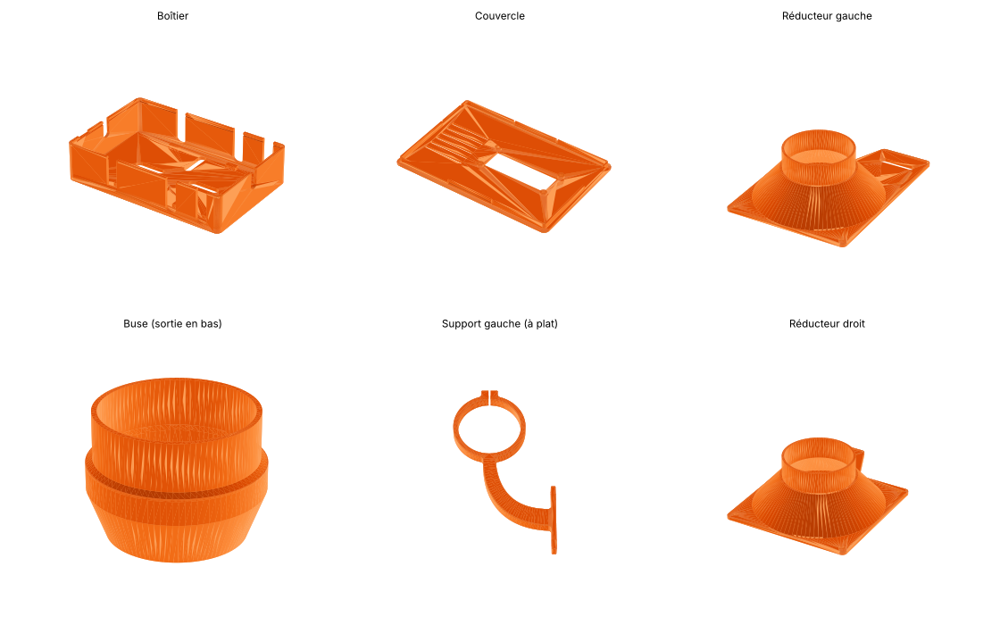
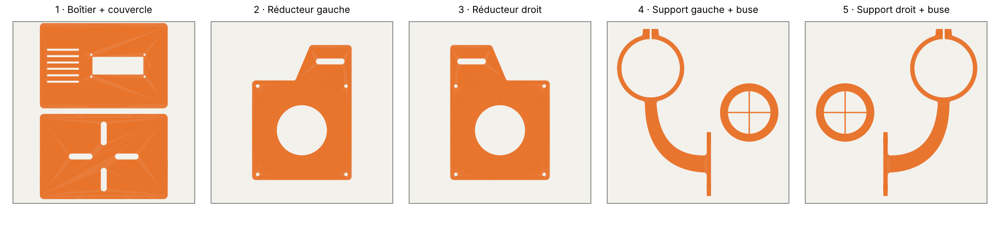

# Wind sim DIY

Simulateur de vent pour le sim racing (LMU, ACC…) : 2 ventilateurs Noctua 140 mm pilotés en PWM par un Arduino Uno et SimHub, l'air amené aux mains par deux tuyaux de 76 mm. Toutes les pièces s'impriment en PETG sur une Bambu Lab A1, sans supports.

Environ **CHF 65** de matériel neuf si vous avez déjà un starter kit Arduino, une alimentation 12 V et une imprimante 3D.



> ⚠️ Projet personnel en cours : les pièces ont été vérifiées en modèle (maillages fermés, tailles, surplombs), pas encore imprimées ni montées. Imprimez d'abord le couvercle, une buse et un support pour valider les ajustements.

## Sommaire

1. [Matériel](#1-matériel)
2. [Pièces imprimées](#2-pièces-imprimées)
3. [Câblage](#3-câblage)
4. [Firmware](#4-firmware)
5. [SimHub](#5-simhub)
6. [Montage sur le rig](#6-montage-sur-le-rig)
7. [Modifier les pièces](#7-modifier-les-pièces)
8. [Dépannage](#8-dépannage)

## 1. Matériel

Prix relevés en novembre 2026, en CHF TVA comprise ; ils changent souvent.

| Article | Qté | Prix | Où |
|---|---|---|---|
| Noctua NF-A14 industrialPPC-3000 PWM (140 mm, 158,5 CFM, 0,55 A) | 2 | 44.00 | Digitec, art. 2753656 |
| Tuyau d'admission d'air flexible 76 mm, fil d'acier | 2 | 13.82 | AliExpress 1005008557473204 |
| Connecteurs à levier PCT-222/224 (AWG 28-12) | 1 lot | 2.84 | AliExpress 1005012376764998 |
| Adaptateur I2C PCF8574 pour écran 1602 | 1 | 1.05 | AliExpress 1005006771130640 |
| Gaine thermorétractable, assortiment | 1 lot | 2.95 | AliExpress 1005008146302901 |
| **Total** | | **64.66** | |

Déjà disponible ou à récupérer :

- Arduino Uno R3, écran LCD 1602, barrette de picots et fils du starter kit
- Alimentation 12 V à découpage, **1,5 A minimum** (2 × 0,55 A + marge)
- 2 rallonges de ventilateur 4 broches (pour ne **pas** couper les câbles Noctua et garder la garantie de 6 ans)
- Visserie : 10 vis M8 12–16 mm + rondelles + écrous en T (rainure 8 ou 10 mm selon le profilé), 4 vis M3 × 12 à tête fraisée + écrous (écran), 2 vis M4 × 25 + écrous (colliers des supports), 4 colliers de serrage 70–90 mm (tuyaux), quelques colliers rilsan fins 2,5–3,6 mm (serre-câbles du boîtier)

Pourquoi les NF-A14 iPPC-3000 : 0 tr/min à 0 % de PWM (silence total à l'arrêt), forte pression statique (6,58 mm H₂O) pour pousser dans un tuyau, et un connecteur 4 broches qu'un Arduino pilote directement, sans MOSFET.

## 2. Pièces imprimées

Fichiers dans [`stl/`](stl), déjà orientés pour l'impression. Guide complet pour l'imprimeur : [`docs/GUIDE-IMPRESSION.pdf`](docs/GUIDE-IMPRESSION.pdf).

| Fichier | Qté | Taille (mm) | Rôle |
|---|---|---|---|
| `windsim-boitier-arduino.stl` | 1 | 180 × 120 × 55 | Boîtier de l'Arduino, 2 × M8 sur un profilé série 40 |
| `windsim-couvercle.stl` | 1 | 180 × 120 × 11 | Couvercle clipsé sans vis, écran vissé dessus |
| `windsim-reducteur-gauche.stl` | 1 | 140 × 190 × 80 | Ventilateur 140 mm → tuyau 76 mm, patte M8 d'un côté |
| `windsim-reducteur-droit.stl` | 1 | 140 × 190 × 80 | Miroir du gauche |
| `windsim-buse-76.stl` | 2 | 82 × 82 × 79 | Buse au bout du tuyau, sortie 60 mm, ailettes en croix |
| `windsim-support-buse-gauche.stl` | 1 | 132 × 235 × 20 | Bras courbe qui tient la buse, collier serré par une M4 |
| `windsim-support-buse-droit.stl` | 1 | 132 × 235 × 20 | Miroir du gauche |

**Réglages (Bambu Lab A1, plateau 256 × 256 mm)** : PETG, plaque texturée (plaque lisse : colle), couches 0,20 mm, 4 parois, 5/4 couches dessus/dessous, 20–25 % gyroïde, **supports désactivés**, ne pas réorienter. Environ 0,6 kg de PETG au total.

5 plateaux : boîtier + couvercle · réducteur gauche · réducteur droit · support gauche + buse · support droit + buse.



## 3. Câblage



| Depuis | Vers | Remarque |
|---|---|---|
| Alim 12 V (+) | connecteur à levier « +12 V » | polarité vérifiée au multimètre |
| Alim 12 V (−) | connecteur à levier « masse » | |
| Ventilateur G et D, fil **jaune** (+12 V) | « +12 V » | |
| Ventilateur G et D, fil **noir** (masse) | « masse » | |
| Arduino **GND** | « masse » | **masse commune obligatoire** |
| Ventilateur G, fil **bleu** (PWM) | Arduino **D9** | picot soudé, gaine thermo |
| Ventilateur D, fil **bleu** (PWM) | Arduino **D10** | picot soudé, gaine thermo |
| Fils **verts** (tachymètre) | — | coupés court et isolés |
| Écran I2C VCC / GND / SDA / SCL | 5V / GND / A4 / A5 | adresse 0x27 ou 0x3F |

Règles à ne pas oublier :

- **Jamais de +12 V sur l'Arduino.** Il est alimenté par l'USB du PC ; le 12 V ne va qu'aux ventilateurs.
- **Masse commune** : sans le fil GND Arduino → masse alim, le signal PWM n'a pas de référence et les ventilateurs tournent à fond en permanence.
- Pas de MOSFET ni de transistor : sur un ventilateur 4 broches, le fil PWM est une simple entrée logique.
- Couleurs Noctua (standard 4 broches) : noir masse, jaune +12 V, vert tachymètre, bleu PWM. Vérifiez sur vos rallonges, certaines utilisent d'autres couleurs.
- Les connecteurs à levier bicolores : testez au multimètre si les côtés bleu et orange sont reliés avant de mettre +12 V et masse dans le même.

## 4. Firmware

Deux étapes :

1. **Test du câblage** : [`firmware/windsim-fan-test/windsim-fan-test.ino`](firmware/windsim-fan-test/windsim-fan-test.ino). Ouvrir dans l'IDE Arduino, carte *Arduino Uno*, téléverser. Les ventilateurs doivent passer par 0, 30, 60 puis 100 % toutes les 4 s (moniteur série à 115200 bauds pour suivre). Il règle Timer1 en PWM 25 kHz, la fréquence attendue par la spécification Intel des ventilateurs 4 broches ; le `analogWrite()` standard tourne à ~490 Hz et fait siffler certains ventilateurs.
2. **Firmware SimHub** : généré et téléversé par SimHub lui-même (section suivante). Il remplace le sketch de test.

## 5. SimHub

1. `Arduino` → `My hardware` → `Single Arduino` → `Open arduino setup tool`.
2. Carte : `Arduino Uno`, port : le COM de l'Arduino.
3. `SHAKEIT PWM FANS Outputs` : activer, **2** moteurs, sortie 1 sur la broche **9**, sortie 2 sur la broche **10**.
4. Écran : activer l'**I2C LCD**, 16 × 2, adresse `0x27` (ou `0x3F` si l'écran reste vide).
5. `UPLOAD TO ARDUINO`.
6. `ShakeIt Wind` : ventilateur gauche → sortie 1, droit → sortie 2.
7. Réglages de départ : puissance max 70–85 %, minimum 15–20 %, plage de vitesse 60–200 km/h. Ajustez ensuite au ressenti.

## 6. Montage sur le rig

Prévu pour un rig en profilé alu série 40 (40 × 40, 40 × 80, 40 × 120).

- **Ventilateur + réducteur** : 4 vis de ventilateur PC classiques (ou celles fournies par Noctua) traversent la bride de 5 mm et se vissent dans le cadre. La patte se boulonne avec 2 vis M8 dans une même rainure (écart 10–30 mm), par exemple derrière les écrans.
- **Tuyau** : enfilé sur l'embout du réducteur et sur celui de la buse, un collier de serrage à chaque bout. Embouts de 75,6 mm pour un tuyau de 76 mm intérieur.
- **Buse** : enfoncée au bout du tuyau jusqu'à la collerette.
- **Support de buse** : platine vissée sur le côté d'un montant vertical, sous le support d'écran (2 × M8 à 66 mm dans la même rainure). Le bras passe devant la plaque du support d'écran et remonte ; le collier serre la bande lisse de la buse avec une M4. Centre de la buse à ~85 mm du montant et ~180 mm au-dessus du bas de la platine.
- **Boîtier** : 2 × M8 au fond (lumières en croix, entraxe 40–90 mm). Les pontets intérieurs servent à passer des colliers rilsan fins pour soulager les câbles.

## 7. Modifier les pièces

Les STL sont générés par deux scripts Python paramétriques (Manifold3D) :

```bash
cd cad
pip install -r requirements.txt
python3 boitier.py   # boîtier + couvercle
python3 tube.py      # réducteurs, buse, supports
```

Paramètres utiles en tête de fichier :

| Fichier | Paramètre | Effet |
|---|---|---|
| `tube.py` | `TUBE_ID` | diamètre intérieur réel du tuyau (mesuré) |
| `tube.py` | `FIT` | jeu entre embout et tuyau |
| `tube.py` | `C = (-85.0, 180.0)` | position du collier : écart au montant, hauteur |
| `tube.py` | `BOLT_Z` | hauteur des 2 trous M8 de la platine |
| `boitier.py` | `SNAP`, `CLEAR` | serrage du clipsage du couvercle |
| `boitier.py` | `LCD_WIN`, `LCD_HOLES` | fenêtre et trous de l'écran |

## 8. Dépannage

| Symptôme | Cause probable |
|---|---|
| Les ventilateurs tournent à fond en permanence | GND Arduino pas relié à la masse de l'alim, ou fil bleu mal branché |
| Rien ne tourne, même à 100 % | +12 V absent ou polarité inversée ; vérifier l'alim à vide (11,5–12,5 V) |
| Sifflement aigu | PWM pas à 25 kHz (firmware de test non flashé ou autre broche que 9/10) |
| Écran allumé mais vide | adresse I2C (essayer 0x3F) ou contraste : potentiomètre bleu au dos de l'adaptateur |
| Le tuyau glisse sur l'embout | ajuster `TUBE_ID` / `FIT`, ou un tour de ruban avant le collier |

## Licence

Code (`firmware/`, `cad/`) sous licence MIT. Modèles 3D et documentation sous CC BY-SA 4.0. Voir [LICENSE](LICENSE).
